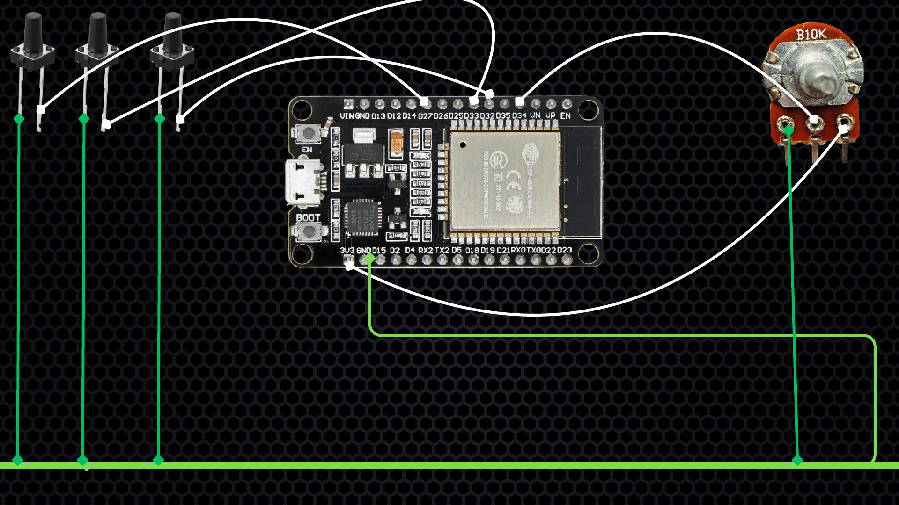

# ESP32 VPS Radio

A wired AUX internet radio for the classic **ESP32-WROOM-32**, with a PHP/FFmpeg gateway for station management, source fallbacks and audio conversion. The ESP32 connects to a fixed origin IP over verified TLS, buffers encoded audio locally, and sends the same mono programme to both AUX channels through GPIO25 and GPIO26.

## Features

- Central management of up to 16 stations with ordered source fallbacks.
- HTTPS certificate-chain and hostname verification, including TLS SNI when connecting to a numeric origin IP.
- Optional **RZ1 lossless transport compression** that restores the original ADPCM bytes.
- About 6.6 seconds of local audio buffering and controlled reconnects.
- Up to five Wi-Fi networks configured locally and stored in NVS.
- Previous, next and pause/resume buttons, saved station selection and volume control.
- Download suspension after ten seconds at zero volume; live playback resumes when volume is raised.
- English management and Wi-Fi setup interfaces.

Bluetooth and LCD support are not included in this wired firmware.

## Audio and bandwidth

FFmpeg produces mono IMA-ADPCM at **14700 Hz**, with **1024-byte blocks**, without a gain boost. RZ1 groups up to eight blocks and uses zlib only when its payload is smaller. The device restores the exact original blocks before the existing decoder and DAC output.

Representative validation samples saved roughly 9-10% of audio transport bytes. Savings depend on the programme and exclude TCP/TLS overhead and other network usage. Raw fallback remains available when compression is not negotiated. Larger buffers alone do not reduce bandwidth.

Short stalls can be absorbed by the buffer. An unavailable source or an outage longer than the available audio can still interrupt playback.

## Quick start

1. Follow the [wiring guide](docs/WIRING.md) with power disconnected.
2. Configure HTTPS and install the [server files](docs/SERVER_SETUP.md), including a trusted FFmpeg executable.
3. Copy `firmware/radio_config.example.h` to a private `radio_config.h`. Set your numeric origin IPv4, certificate hostname, root CA and unique setup password.
4. Build with **Arduino ESP32 Core 3.3.11** and the board's matching partition scheme using the [firmware guide](docs/FIRMWARE_SETUP.md).
5. Connect to `ESP-Radio-Setup`, open `http://192.168.4.1`, and save your 2.4 GHz Wi-Fi networks.
6. Complete HTTPS admin setup at `/esp-radio/admin.php` and configure your station sources.

## Hardware

| Connection | Function |
| --- | --- |
| GPIO25 | AUX Left through its filter and coupling capacitor. |
| GPIO26 | AUX Right through its filter and coupling capacitor. |
| GPIO32 | Previous station button to Ground. |
| GPIO33 | Pause/resume button to Ground. |
| GPIO27 | Next station button to Ground. |
| GPIO34 | Wiper of the 10 kOhm volume potentiometer. |

Use an active speaker's AUX input. Each channel has its own 1 kOhm resistor, 10 nF capacitor and 100 uF coupling capacitor. Full connections and polarity are in the wiring guide.

[View the five wiring pages](docs/WIRING.md#reference-images) or [download the wiring PDF](docs/connection.pdf).

## Repository layout

| Path | Contents |
| --- | --- |
| `firmware/` | ESP32 application, ADPCM and lossless decoders, example settings. |
| `server/` | Gateway, station manager, catalog APIs, health check and access rules. |
| `docs/` | English firmware, server, wiring and transport guides. |
| `tests/` | Synthetic lossless transport checks without deployment data. |
| `scripts/security-check.sh` | Public-release privacy and secret checks. |
| `SECURITY.md` | Private-file rules and deployment security notes. |

## Requirements

- Classic ESP32 with internal DAC; ESP32-S3, C3 and C6 are incompatible with this output path.
- Arduino ESP32 Core 3.3.11; no additional Arduino libraries.
- PHP 8.1 or newer with `proc_open`; `gzcompress` enables lossless transport.
- Apache or LiteSpeed with HTTPS, rewrite support and directory access rules.
- FFmpeg suitable for the host, and hosting that allows long-lived listener processes.

## Privacy and validation

Only example configuration is published. Deployment addresses, private station catalogs, credentials, saved networks, logs, flash dumps, compiled firmware and server binaries are excluded. Public root CA certificates are trust anchors, not private credentials. See [SECURITY.md](SECURITY.md).

The firmware was built and exercised on a classic ESP32 with verified upload, lossless decoding, AUX playback and listener confirmation. This does not establish continuous uptime for every station. GitHub Actions validates public-file hygiene, PHP syntax and synthetic lossless round trips.

## License

No open-source license has been granted. All rights remain with the project owner unless a license is added later.
