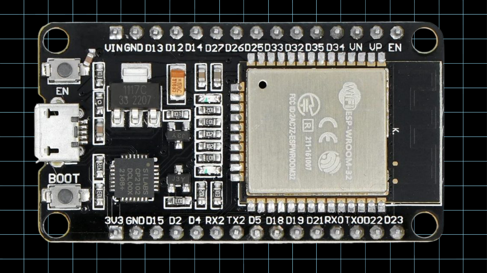
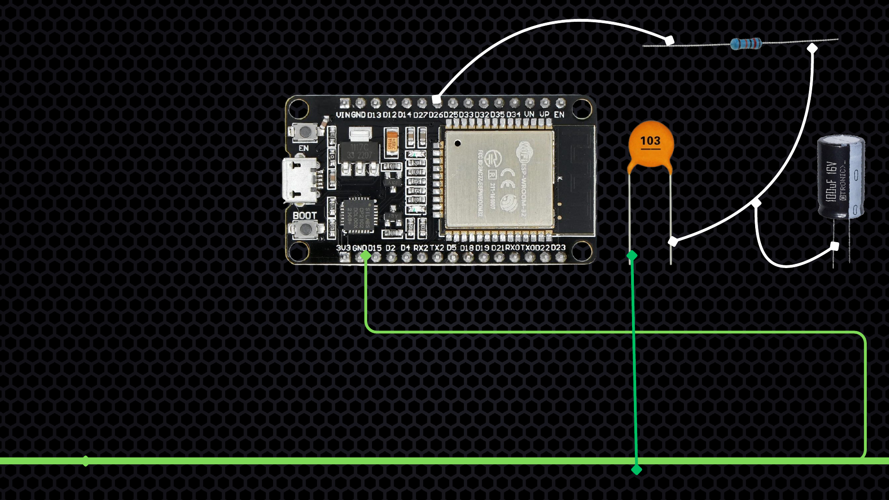
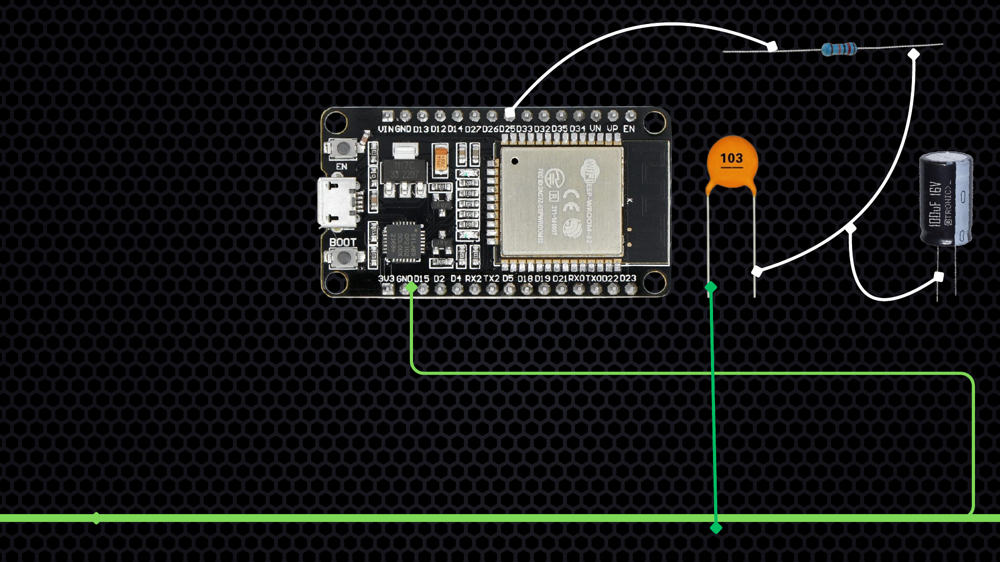
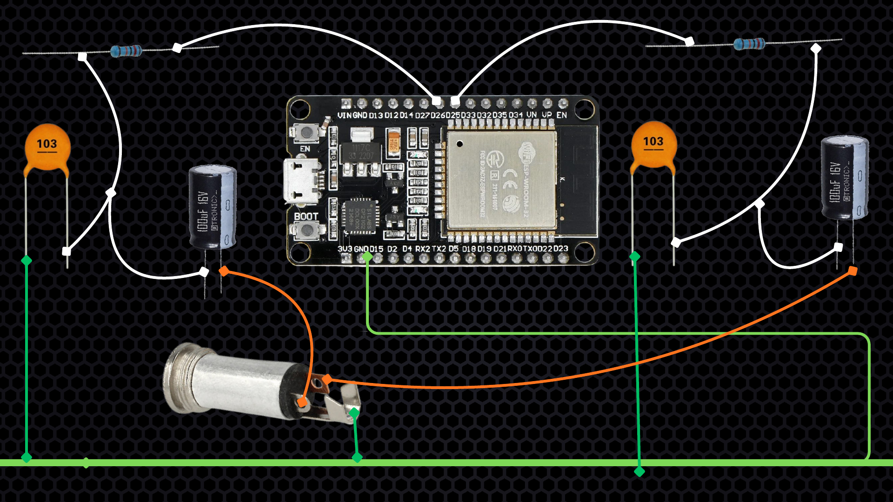

# Wiring the ESP32 AUX radio

Disconnect the board and speaker from power before wiring. Use the AUX input of an active speaker. This circuit does not drive a bare speaker.

## Parts

Classic 30-pin ESP32-WROOM-32, active AUX speaker, 3.5 mm connector with Left/Right/Ground, two 1 kOhm resistors, two 10 nF ceramic capacitors, two 100 uF electrolytic capacitors, three momentary buttons, and a 10 kOhm potentiometer.

## Left channel

1. Connect GPIO25 to one end of a 1 kOhm resistor.
2. Its other end is the left signal node.
3. Connect a 10 nF capacitor between that node and Ground; it has no polarity.
4. Connect a 100 uF capacitor's positive terminal to the same node.
5. Connect its negative terminal, marked with a stripe, to AUX Left.

## Right channel

1. Connect GPIO26 to one end of the second 1 kOhm resistor.
2. Its other end is the right signal node.
3. Connect the second 10 nF capacitor between that node and Ground.
4. Connect the second 100 uF capacitor's positive terminal to the same node.
5. Connect its negative terminal to AUX Right.

Keep each channel's resistor and capacitors independent. Programme audio is mono, duplicated to both AUX channels.

## Audio ground

Join AUX Ground and both 10 nF capacitor grounds at one short audio-ground point, then connect that point to ESP32 Ground with one short wire. Keep audio wiring away from the antenna, USB and controls. Identify unlabelled AUX Tip/Left, Ring/Right and Sleeve/Ground terminals with a multimeter.

## Controls

- Previous button: GPIO32 to Ground.
- Pause/resume button: GPIO33 to Ground.
- Next button: GPIO27 to Ground.
- Potentiometer middle terminal: GPIO34.
- Potentiometer outer terminals: 3.3 V and Ground.

Buttons use `INPUT_PULLUP`. On four-leg buttons, choose terminals from opposite sides. Swap the potentiometer's outer connections if its direction is reversed; never apply 5 V to GPIO34.

Hold Previous and Next for four seconds to open Wi-Fi setup. Pause closes the stream; ten seconds at zero volume stops downloading, and raising volume resumes live playback after buffering.

## Reference images

The [five-page wiring PDF](connection.pdf) and these images show the original connections. Wiring did not change for TLS or lossless transport.

